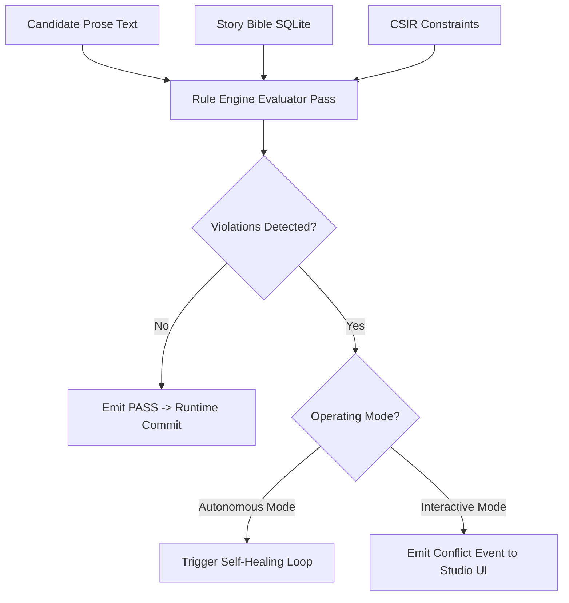

# NSPEC-006: Rule Engine, Invariant Verification & Self-Healing Loops

---
Document Status: Approved & Locked
Document Version: 1.0.0
NSPEC Compatibility:
  minimum: 1.0
  maximum: 1.x
API Compatibility:
  minimum: 1.0
  maximum: 1.x
Owner: Rule Engine & Quality Assurance Teams
Last Updated: 2026-10-10
Normative Standard: RFC 2119 Compliance
---

## Document Rules & Strict Hierarchy Law

This specification is normative and governs the formal validation algorithms, narrative invariant enforcement, diagnostic classification, and automated **Self-Healing Loops** within the Novelis ecosystem.

All implementations MUST conform strictly to the definitions in `GLOSSARY.md` and the constitutional principles locked in `NSPEC-000`.

**Strict Downward-Only Document Dependency Law:**
This document depends solely upon `GLOSSARY.md`, `NSPEC-000`, `NSPEC-001`, `NSPEC-002`, `NSPEC-003`, `NSPEC-004`, and `NSPEC-005`. It SHALL NOT import or depend upon concepts defined in specifications positioned below it.

```plaintext
       [ GLOSSARY.md ] (Lexicon Single Source of Truth)
              │
              ▼
       [ NSPEC-000 ] (Core Philosophy & Constitution)
              │
              ▼
       [ NSPEC-001 ] (Domain Ontology & Canonical Model)
              │
              ▼
       [ NSPEC-002 ] (Narrative Memory Architecture & Story Bible)
              │
              ▼
       [ NSPEC-003 ] (Story Blueprint & Artifact Specification)
              │
              ▼
       [ NSPEC-004 ] (CSIR & Compiler Specification)
              │
              ▼
       [ NSPEC-005 ] (Autonomous Runtime VM Specification)
              │
              ▼
       [ NSPEC-006 ] (Rule Engine & Invariant Verification)  ◄── [Current Layer]
              │
              ▼
       [ NSPEC-007 ] (Renderer Layer & Prose Generation)
              │
              ▼
       [ API-SPEC Suite ] (Control, Telemetry & Data Planes)
```

---

## Abstract

This specification establishes the technical standard for the **Novelis Rule Engine**. The Rule Engine is the guardian of narrative integrity across the story build lifecycle. It validates candidate prose against the immutable Canon, epistemic knowledge boundaries, and world invariants declared in the Story Bible. When candidate text violates narrative constraints, the Rule Engine triggers an automated **Self-Healing Loop** in Autonomous Mode, synthesizing precise corrective instructions to re-align prose generation without human intervention, or pauses execution to solicit human author guidance in Interactive Mode.

---

## 1. Mathematical Taxonomy of Narrative Invariants

The Rule Engine evaluates three orthogonal classes of narrative invariants:

$$\mathcal{I}_{\text{total}} = \mathcal{I}_{\text{canon}} \cup \mathcal{I}_{\text{epistemic}} \cup \mathcal{I}_{\text{world}}$$

```plaintext
┌────────────────────────────────────────────────────────────────────────┐
│                   Narrative Invariant Taxonomy                         │
├──────────────────────────┬─────────────────────────────┬───────────────┤
│    Canon Invariants      │    Epistemic Invariants     │  World Laws   │
│   (Physical & Identity)  │   (Information Boundaries)  │(Axioms/Magic) │
├──────────────────────────┼─────────────────────────────┼───────────────┤
│ • Life/Death status      │ • Character belief scope    │ • Magic costs │
│ • Physical anatomy       │ • No metagaming / telepathy │ • Tech limits │
│ • Spatial co-presence    │ • Secrets & covert reveals  │ • Travel time │
│ • Item conservation      │ • Misunderstandings         │ • Metaphysics │
└──────────────────────────┴─────────────────────────────┴───────────────┘
```

### 1.1 Canon Invariants ($\mathcal{I}_{\text{canon}}$)
Enforces absolute physical and factual continuity:
* **Life Status Invariant:** An entity $c$ with `life_status == DECEASED` SHALL NOT perform active verbs (speaking, moving, deciding) in present simulation scenes.
* **Conservation of Unique Artifacts:** A unique item $i$ (`item_inquisitorial_seal`) CANNOT reside simultaneously in multiple disjoint inventories.
* **Spatial Co-presence:** Two characters CANNOT engage in physical combat or face-to-face dialogue unless their active locations match:
  $$\text{loc}(c_1, T) = \text{loc}(c_2, T)$$

### 1.2 Epistemic Invariants ($\mathcal{I}_{\text{epistemic}}$)
Enforces information containment across characters:
* **The No-Omniscience Rule:** A character $c$ SHALL NOT state, infer, or act upon a factual proposition $p$ unless $p \in \mathcal{K}_c(T)$ in the Story Bible.
* **Point of View (POV) Containment:** In `THIRD_PERSON_LIMITED` or `FIRST_PERSON` mode, the prose SHALL NOT reveal the internal monologue or bodily sensations of non-POV characters.

### 1.3 World Invariants ($\mathcal{I}_{\text{world}}$)
Enforces universal world laws ($\Phi_{\text{world}}$):
* Non-negotiable physical laws (e.g., travel time between cities, energy costs of spells, technological prerequisites).

---

## 2. Invariant Verification Algorithm

Invariant verification operates as an evaluative cross-referencing function $f_{\text{eval}}$:

$$f_{\text{eval}}: \left( \text{Prose}_{\text{candidate}}, \text{CSIR}, \mathcal{B}(T) \right) \to \left\langle \text{Status}, \mathcal{V}_{\text{violations}} \right\rangle$$

Where $\text{Status} \in \{\text{PASS}, \text{FAIL}\}$, and $\mathcal{V}_{\text{violations}}$ is a collection of typed violation records.



---

## 3. The Self-Healing Loop (Autonomous Mode)

When candidate prose fails validation in Autonomous Mode, the Pipeline Manager automatically engages the **Self-Healing Loop**:

### 3.1 Repair Strategy Formulation
The Rule Engine converts violation diagnostics into a structured **Corrective Guidance Payload**:

```json
{
  "repair_attempt": 1,
  "max_allowed_attempts": 3,
  "violation_count": 1,
  "diagnostics": [
    {
      "invariant_type": "EPISTEMIC_CONTAINMENT",
      "severity": "CRITICAL",
      "description": "Character 'Aria' confronts 'Kael' regarding his inquisitorial rank, but Aria has not yet seen the seal.",
      "violating_passage": "\"I know what you are, Kael,\" Aria whispered. \"An Inquisitor of the Sunken Spire.\"",
      "corrective_instruction": "Rewrite the dialogue so Aria remains suspicious without explicitly knowing Kael's official title. Have her notice the concealed dagger on his belt first."
    }
  ]
}
```

### 3.2 Targeted Re-prompting
1. The VM injects the original CSIR payload, the flawed draft, and the `corrective_instruction` into a focused revision prompt.
2. The drafting model produces an amended draft focusing strictly on resolving the flagged contradictions while preserving stylistic cadence.
3. The amended draft re-enters the Rule Engine verification pass.

### 3.3 Escalation Policy
* If the Self-Healing Loop fails to achieve a `PASS` within 3 attempts, the system halts autonomous execution, marks the scene as `HEALING_EXHAUSTED`, and transitions the build to `PAUSED` state, alerting the author via the Telemetry Plane.

---

## 4. Conflict Resolution Protocol (Interactive Mode)

In Interactive Mode, detected violations do not trigger unguided retries. Instead, the Rule Engine transmits an interactive conflict payload to Novelis Studio over the Dual-Plane API (`POST /api/v1/builds/{id}/conflicts/{conflict_id}/resolve`):

```json
{
  "conflict_id": "cnf_01h9x88a",
  "scene_id": "scn_c01_s01",
  "error_type": "CANON_VIOLATION",
  "summary": "Lord Cassian is dead at Epoch 4, but appears at the council in Scene 5.",
  "available_resolutions": [
    {
      "option_id": "OPT_REWRITE_PROSE",
      "label": "Regenerate Scene Without Cassian",
      "description": "Instructs the generator to substitute Cassian with his appointed steward."
    },
    {
      "option_id": "OPT_OVERRIDE_CANON",
      "label": "Revive Cassian in Canon",
      "description": "Applies a State Delta retroactively marking Cassian's death as a faked assassination."
    },
    {
      "option_id": "OPT_MANUAL_EDIT",
      "label": "Edit Text in Studio Editor",
      "description": "Opens the prose in the authoring canvas for manual author revision."
    }
  ]
}
```

---

## 5. Verification & Compliance Standards

Implementations of the Novelis Rule Engine MUST satisfy the following test criteria:

1. **Deterministic Rejection of Deceased Actors:** The Rule Engine MUST reject 100% of generated scenes where an entity marked `DECEASED` initiates independent dialogue or physical actions.
2. **Epistemic Leak Detection:** The Rule Engine MUST intercept and flag dialogue revealing secret propositions when the speaker lacks the corresponding record in `character_knowledge`.
3. **Bounded Healing:** The Self-Healing Loop MUST strictly observe `max_allowed_attempts` and never enter an infinite generation loop.
